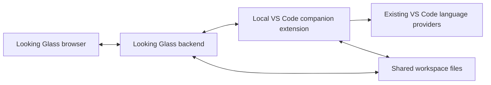

# Local VS Code bridge specification

This specifies a future optional feature. The current application does not
implement the extension, synchronization protocol or file locks described here.

## Agreed behavior

- Connect to **Microsoft VS Code on the same machine as Looking Glass**, using
  a companion extension and the same files in the same workspace directory.
- A save in either application updates the other application's clean view of
  that file. Each save writes the shared file once; notifications do not trigger
  a second save, autosave, Git commit or checkpoint.
- When VS Code has an unsaved draft, **lock both editing and saving for that
  file in Looking Glass**. Preserve any existing Looking Glass draft and undo
  state. The lock is per file; other files remain usable.
- Show a small, static lock icon beside the filename. Explain the reason on
  hover or keyboard focus. Routine locking does not show a banner, toast, modal,
  animation or repeated notification.
- Use VS Code language providers only for a saved, synchronized Edit buffer.
  Unsaved Looking Glass Edit buffers keep existing Jedi definition lookup and
  local CodeMirror suggestions until saved. Do not mirror drafts into VS Code.
- Review mode never uses VS Code language providers. Review proposals remain
  separate from the original file and keep existing local language support.

## Scope and architecture

The first version supports existing UTF-8 text files inside the paired workspace,
with Python definitions, explicit completions and hover as the initial language
journey. The protocol can carry other installed providers' results, but does not
promise support for every extension. VS Code Remote-SSH, WSL, Dev Containers,
Coder code-server, cross-machine copies and outside-workspace files are deferred.
Untitled documents and custom URI schemes are not paired disk files.

The extension runs inside the existing local extension host. It uses public
document events, dirty/version state and provider commands. Looking Glass keeps
its browser/backend architecture, ordinary save path and persistent discussions.
It does not connect directly to private VS Code Server internals, copy an
extension's language-server binary or start another analyzer for this bridge.

Pairing is explicit through a **Connect to Looking Glass** extension command and
a workspace connection setting. Verify the canonical directory and identify one
VS Code window/extension session per workspace in version one. Reject a second
pairing rather than silently selecting a window. Other unpaired windows and
applications remain ordinary external writers, outside the coordinated lock.
Connecting supplies an initial snapshot, including already-dirty documents;
opening a file in Looking Glass must not wait for the next VS Code edit to learn
that it is dirty.

## File state and presentation

Maintain bridge connection state separately from each document session's content,
disk hash, draft, conflict and per-mode undo state. A VS Code lock must not turn
into a permanent `readOnly` editor preference when tabs or modes are restored.

| VS Code state | Looking Glass state | Editing and saving | Language support |
| --- | --- | --- | --- |
| Connected, clean, matching disk text | Clean Edit buffer | Normal editing and guarded saves | VS Code providers eligible |
| Connected, clean | Unsaved Edit buffer | Normal editing and guarded saves | Existing Jedi/local suggestions |
| Dirty | Any buffer for that file | Read only; saves and approval blocked; drafts retained | No VS Code requests or completion application; read-only local navigation remains available |
| Clean after VS Code saves; disk differs from a retained Looking Glass draft's base | Conflicted draft | Remove the VS Code lock; preserve draft and require explicit comparison before saving | Local support for the draft |
| Disconnected or status expired after pairing | Any paired file | Block disk writes until resynchronized or explicitly disconnected; previously locked files stay read only | Existing local support |
| Bridge explicitly disabled or never connected | Any file | Existing standalone behavior | Existing local support |

For temporarily unknown bridge status, files not previously locked may retain
local draft editing, but cannot write disk. An unknown state is never interpreted
as proof that VS Code is clean. A user-initiated disconnect can return to normal
standalone editing after explaining that VS Code's dirty-file protection ends;
it must not save, discard or replace either application's draft.

For a known dirty file, the lock applies to content editing in both Edit and
Review modes, even though a Review proposal is stored separately. Selection,
copy, scrolling, tabs, original context and existing discussion replies remain
available. Already-queued Review operations may finish persisting to the
Looking Glass database to preserve work; they must not write the original.

Use one theme-matched SVG lock in a stable filename position, with an accessible
name and focusable explanation: **Read only — unsaved changes in VS Code**.
For inactive tabs, provide the same small lock indication beside the tab name.
Disable Save and Approve controls. Announce the transition once to assistive
technology. A blocked explicit save shortcut may report its reason quietly in
the existing status area; routine polling must not repeat it or steal focus.
Content conflicts continue to use the existing explicit comparison UI because
they require a choice; the quiet lock indicator does not conceal a conflict.

## Save and unlock flows

### VS Code saves

1. Dirty-state changes report the file URI, document version and connection
   sequence promptly. Do not debounce the clean-to-dirty lock notification.
2. After a successful native save, including VS Code's own enabled Auto Save or
   Save All, publish a saved-file event. Observe the final bytes after formatting
   and save participants. A failed save does not release the dirty lock.
3. Looking Glass reads the shared file through its existing versioned file path
   and reconciles discussion anchors and tracked TODO/NOTE comments normally.
   An event is an invalidation hint, not an instruction to trust supplied bytes.
4. If Looking Glass has no draft, reload the new version while retaining valid
   selection, scroll and sidebar state. Refresh inactive clean tabs without
   activating them. Unchanged events must not remount the document.
5. If Looking Glass has a draft, retain it with its original base and undo stack.
   When disk changed, offer the existing compare/merge or explicit discard flow.
   Never replace the draft or automatically save it over VS Code's saved text.
6. Release the VS Code lock only after a fresh snapshot confirms that the current
   document is clean and its saved version is reconciled. If VS Code immediately
   becomes dirty again, the newer state wins.

VS Code undo-to-clean, explicit discard or close can also release a lock after
reconciliation proves the current state. A close event alone or a broken
connection is insufficient. On reconnect, restored/hot-exit dirty buffers must
appear in the full initial snapshot before writes are enabled.

### Looking Glass saves

1. Preserve the candidate draft. The backend checks live bridge state and the
   expected disk version before accepting any coordinated write. A cached
   browser indication is insufficient authorization to write.
2. If VS Code is dirty or live status cannot be confirmed, reject the write
   without discarding the draft. A dirty-state response also applies the file's
   read-only lock to every Looking Glass session viewing that file.
3. Otherwise use the existing atomic replacement and stale-version checks.
   Publish a saved-file event containing path, content hash and event identity.
4. VS Code's file watcher reloads a clean document. The extension verifies the
   resulting document text/version before declaring provider eligibility. Do
   not force-revert a document, replace a dirty VS Code buffer, call Save on its
   behalf or depend on a private workbench reload command.
5. If VS Code became dirty during the write/reload window, retain both drafts,
   lock Looking Glass and surface any content conflict. Never mark a failed or
   superseded save as acknowledged. Retain the candidate and pre-save base until
   the operation's outcome is established; an ambiguous outcome is reconciled
   by hashes rather than a blind write retry.

Notifications carry origin/session, monotonically increasing sequence, operation
ID and version/hash. Duplicate or out-of-order notifications are harmless and
never create save loops. Reconnect uses a new connection epoch and full snapshot,
so an old queued clean event cannot unlock a newly dirty document.

Dirty-state events are asynchronous: this is cooperative coordination, not an
operating-system file lock or a transaction spanning VS Code's native writes.
Recheck status near the write, preserve work in overlapping-save races, and keep
both applications' ordinary external-change safeguards. Public save-participant
events are not a reliable global save veto. Proving a stronger exclusion guarantee
would require additional writer coordination and is not claimed by this design.

## Enforcing the lock

The frontend disables content-changing paths, including typing, paste, drop,
undo/redo and formatting, without destroying the editor state. Add a separate
bridge lock reason rather than overloading existing mode/approval locks.

The backend enforces the same guard for ordinary file saves, Review approval,
and explorer rename/move/delete affecting a locked file or its containing folder.
Route managed writes through a shared guard so a shortcut, implicit pre-comment
save, API/CLI request or another browser tab cannot bypass it. Database discussion
updates may continue. If starting a thread requires saving a dirty source buffer,
retain the composer and explain that the save is blocked; never anchor against
different disk text. Binary editor state is outside this text-document bridge.

Review autosave remains a database operation; Review approval remains explicit
and checks both the original disk hash and current VS Code state. A VS Code save
updates the original/Edit view, not the Review proposal or its immutable base.
A stale Review approval requires existing conflict resolution. Approved source
changes notify VS Code through the same saved-file flow as an ordinary save.

## Language requests

The extension forwards documented definition, completion and hover commands.
It may open the saved `file:` document without showing it or changing VS Code's
active editor. Reuse its configured interpreter and existing provider context.

Request eligibility requires Edit mode, no local draft/conflict/lock, a live
paired session, a clean VS Code document, and matching Looking Glass, disk and
VS Code text. A disk hash alone is insufficient while VS Code's clean view is
still awaiting its file-watcher update. Account for LF/CRLF, BOM and encoding
when comparing disk bytes and decoded text; unsupported encodings fall back.

Include request ID, connection epoch, path, saved hash, document version and
position. Verify identity/version before and after the provider call and again
before applying a result. A new edit, lock, save, mode/tab/workspace change or
reconnect invalidates outstanding results. Convert VS Code's zero-based UTF-16
positions using explicit adapters; keep the existing Python code-point endpoint
contract unchanged.

VS Code completions are explicitly requested on a saved buffer. Typing makes
the Looking Glass buffer dirty and immediately returns to local suggestions;
completion results from the saved revision must not be applied to that draft.
Accepting a valid completion edits only Looking Glass, creating an ordinary
unsaved draft. Do not run arbitrary completion commands; support validated text
edits/snippets in the current file only, or omit unsupported items. Reuse existing
acceptance keys; changing Tab's indentation behavior is a separate decision.
Constrain definition destinations to existing workspace path rules and render
hover Markdown through the existing sanitizer.

Timeouts, unavailable providers or disconnected sessions fall back to existing
local behavior without starting VS Code or a new language server. Review mode
never dispatches provider requests, even when its text happens to equal disk.

## Connection and resource budget

Use the existing loopback backend as the browser's only bridge endpoint. The
extension connects locally using a scoped, expiring pairing credential. A bounded
HTTP long-poll request channel plus event/result posts is sufficient; WebSockets
are not required. Scope credentials to one workspace and connection epoch;
preserve existing browser token/origin protection. Do not log or commit tokens,
and keep any discovery metadata under excluded application metadata.

Proposed protocol messages are `hello/snapshot`, `document-state`, `saved`,
`state-request`, `provider-request`, `provider-result` and `heartbeat`. They are
new interfaces, not endpoints implemented by the current API. Bound pending
requests, event batches, payloads, provider deadlines and retained state. An event
gap requires a snapshot. Disconnect, root switch and extension shutdown cancel
pending requests and invalidate cached eligibility.

Send state changes rather than full file bodies or per-keystroke analysis calls.
Cache hashes by document version/file fingerprint. Reuse existing conditional
file polling as recovery, not as an additional whole-workspace scan. Inactive
files do not generate language requests or steal focus on reload.

| Item | Initial estimate or target |
| --- | --- |
| Production code across extension, backend and frontend | Roughly 500–900 additional lines; excludes tests and generated bundles |
| Focused tests and fixtures | Roughly 250–450 lines; refine after the API prototype |
| Runtime packages | Target zero new third-party runtime packages; use Node's built-in HTTP in the existing extension host and Python's existing server/standard library |
| Installation | One companion extension; no additional standalone Node.js runtime or analyzer process for Looking Glass |
| Development dependencies | VS Code API typings and possibly TypeScript/build tooling if used for the extension |
| Memory and CPU | Small additional protocol/state buffers; no duplicate index. Provider queries can still grow the existing provider's cache and consume CPU |
| Latency | One local request round trip plus provider work. Measure lock propagation, reload, provider latency and browser rendering separately; no current benchmark establishes the bridge's latency |

The existing Jedi/Parso fallback remains installed. No performance or compatibility
claim follows merely from sharing a provider. A prototype must verify saved-file
refresh and installed-provider behavior. Provider licensing must also permit the
intended use; this spec does not assume permission to expose proprietary Pylance
as an unrestricted external service. Use a compatible provider for validation
and do not extract or redistribute Microsoft extension binaries.

## Acceptance and validation

1. Pair with an existing local VS Code workspace, including an already-dirty
   file. Verify root/URI matching, initial snapshots and refusal of a second pair.
2. Save from each application, including VS Code Auto Save, Save All, formatter
   output and failed saves. Verify identical final bytes and no echoed save loop.
3. Make VS Code dirty: Looking Glass becomes read only for that file, disables
   Save/Approve and shows only the quiet lock icon. Verify keyboard, paste/drop,
   undo/redo, implicit saves, backend/CLI writes and explorer operations. Preserve
   local drafts, independent mode state, undo, selection and scroll.
4. Save or discard in VS Code: unlock only after fresh reconciliation. A retained
   Looking Glass draft either resumes unchanged against the same base or enters
   explicit comparison against changed disk text. Never auto-save or auto-merge.
5. Exercise event reordering/duplication, connection loss during a dirty buffer
   or save, process/window restart, hot-exit restoration, save/dirty races, stale
   provider results, other browser tabs and explicit standalone disconnect.
6. Verify saved Edit definition/completion/hover requests and immediate local
   fallback on unsaved edits. Cover accepted completion edits, rejected command
   items, changed destination drafts, Unicode, CRLF, BOM and unsupported encodings.
7. Verify zero VS Code language requests in Review, separate proposal autosaves,
   blocked/stale approvals, approval notifications and discussion-anchor retention.
8. Inspect light/dark, narrow layouts, inactive tab locks, keyboard focus, screen
   reader labels and unchanged-poll stability. No routine lock banner or toast.
9. Run protocol/backend/state tests, real VS Code extension-host integration
   tests, and Chromium/Firefox user journeys. Mock-provider tests alone do not
   establish native file-watcher, dirty-state or installed-provider behavior.

This documentation change does not implement the feature or change current
application behavior. Implementation begins with a small real extension-host
prototype of clean-file refresh, dirty-state detection and provider forwarding;
the race and licensing constraints must be verified before claiming readiness.

## Reference contracts

- [VS Code document state, events and save participants](https://code.visualstudio.com/api/references/vscode-api)
- [Public definition, completion and hover commands](https://code.visualstudio.com/api/references/commands)
- [Microsoft extension usage restrictions](https://code.visualstudio.com/docs/supporting/faq#_can-i-use-a-microsoft-extension-outside-of-vs-code)
- [Current coding behavior and fallback](CODING_SUPPORT.md)
- [Review contract](REVIEW_MODE.md) and [state contracts](STATE_CONTRACTS.md)
